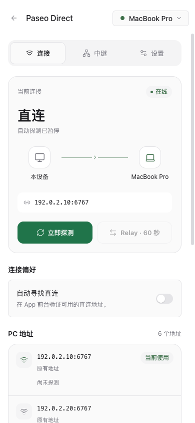
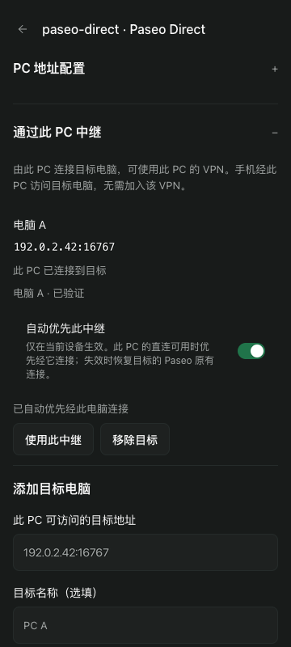

# Paseo Direct

Automatically find a direct path from your phone to your PC while Paseo is in the foreground. Paseo Direct verifies each reachable address against your paired PC before saving it, and keeps the existing relay connection available for fallback.

## Get started

Pair your phone with this PC using relay, enable the plugin, and open **Paseo Direct** in the sidebar or this host’s plugin settings. Allow local network access when requested. Mobile foreground checks start automatically; desktop and web checks are off by default.

After upgrading, update every PC that provides this plugin to the same version, then fully quit and reopen Paseo on your phone to reload the shared routing policy and message synchronization.

The PC must expose a TCP endpoint reachable from your device. The plugin reads the actual daemon listener; it does not change the listener, firewall, port forwarding or relay configuration.

## Choose how to connect

**Prefer direct** saves and activates a verified connection. **Let Paseo choose** saves new verified addresses and lets Paseo’s latency policy choose the transport. You can also connect to a specific address, use relay for 60 seconds, and remove inactive addresses added by this plugin.

Device preferences persist separately for each PC. Shared PC settings support ignored interfaces and additional DNS, IPv4, IPv6 or TLS WebSocket addresses. Automatic interface discovery uses IPv4.

## Use a PC as a relay

Open **Use this PC as a relay** on a VPN-connected Paseo PC and save a target address reachable from that PC. Pair the phone with both PCs, keep an original connection to the target, and enable **Automatically prefer this relay**. The app verifies the direct link to the relay PC and the forwarded target connection, automatically returns to the target's original Paseo connections when either hop fails, and retries the preferred route with backoff. The target PC does not need this plugin.

The preference is saved only on the current device, separately for each target. It runs in the foreground even when the plugin page is closed. An online relay PC using public Relay is not treated as a direct path. Manual relay or direct selection pauses automatic routing for 60 seconds. If all original paths are also unavailable, Paseo and the plugin keep retrying.

After the app resumes, a route that was healthy before suspension is reverified when the relay PC's direct connection returns. A temporary wait for that connection does not count as a failed route check. Real failures retry after 30–300 seconds; failure cooldown and manual pauses survive plugin reloads.

Target connections and any target Paseo password are stored by the relay PC's native host registry and shared with clients authorized to use that PC. Only targets added by this plugin can be removed here; disabling the plugin leaves native targets saved. Host forwarding requires compatible host and App capabilities.

## Data access

The plugin reads PC network interfaces and the daemon’s runtime listener. On the device it uses Paseo’s existing authentication in memory, manages direct connections through the App, and saves preferences in its own local storage namespace. Existing passwords and pairing credentials are excluded from plugin settings and diagnostics.

The device keeps a bounded connection history in memory: disconnect categories, connection changes, heartbeat timing, foreground delays and message-type counts. It does not collect message or file contents, passwords or pairing credentials.

Diagnostics are sent only when you press **Send diagnostics to PC**. They include candidate addresses, connection state, recent events, plugin version and the connection history. They go to the currently connected PC, which keeps up to 12 latest device reports in memory and also writes them to plugin logs. There are no automatic diagnostic uploads.

## Compatibility

Supports Paseo **0.13.0 and later**, with no upper version limit. Required private App connection APIs are checked at runtime; operations stop if they are unavailable. Android 0.13.2 has completed the direct → relay → direct Wi-Fi test, and manual PC forwarding was confirmed on Android 0.15.0. Sustained routing recovery after upgrading and iOS still need device validation.

Checks run only in the foreground. There is no background service, NAT traversal or automatic IPv6 discovery. Paseo handles saved connections; the automatic routing policy also verifies and restores a saved non-forwarded path when the preferred relay fails. Plain WebSocket connections follow Paseo’s existing trust model and should be used on trusted LAN / VPN networks; use properly configured TLS on untrusted networks.

Disabling the plugin stops its checks and leaves saved connections available in Paseo.
