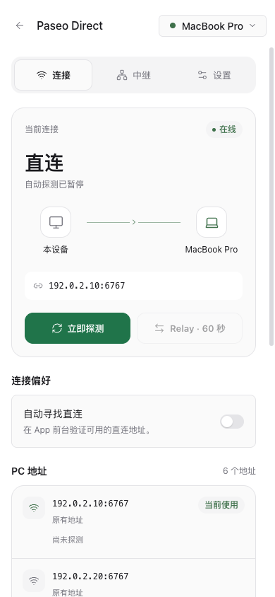
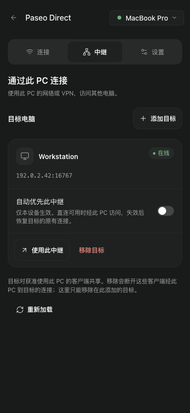

# Paseo Direct

手机在 Paseo 前台时自动寻找直连 PC 的地址，验证属于已配对的 PC 后保存，并保留已有 Relay 作为回退连接。

## 开始使用

先通过 Relay 完成手机与此 PC 的配对，启用插件，再打开侧边栏或主机插件设置中的 **Paseo Direct**。如提示本地网络权限，请允许访问。手机前台默认自动探测；桌面与网页默认关闭。

升级时，请将提供此插件的各 PC 更新到同一版本，再完全退出并重新打开手机 Paseo，以重新加载共享选路策略和消息同步。

PC 需要提供手机可访问的 TCP 端口。插件读取实际监听地址，不会修改监听、防火墙、端口映射或 Relay 配置。

界面跟随 Paseo 主题，分为 **连接 / 中继 / 设置**：连接页显示实际路径、状态、探测和地址；中继页管理目标电脑；设置页集中设备偏好、PC 地址配置与诊断。切换入口保留地址和名称草稿；关闭添加弹窗或离开中继页会清空密码。

## 连接偏好

**优先直连**会保存并激活验证成功的连接；**由 Paseo 选择**只保存新地址，交给 Paseo 的延迟策略选择。也可连接指定地址、使用 Relay 60 秒，或移除插件添加且未使用的地址。

设备设置按 PC 分别持久保存。PC 共享设置支持忽略网卡、补充 DNS / IPv4 / IPv6 / TLS WebSocket 地址；自动网卡发现仅使用 IPv4。

## 通过 PC 中继

在已登录 VPN 的 Paseo PC 上进入 **中继 → 添加目标**，保存该 PC 可访问的目标地址。手机与两台 PC 配对，保留目标电脑的原有连接，再开启 **自动优先此中继**。App 验证到中继 PC 的直连与到目标的转发通道，任一段失效时自动恢复目标的 Paseo 原有连接，并带退避地重试中继。手机无需登录 VPN，目标电脑无需安装此插件。

偏好仅在当前设备、按目标分别保存，关闭插件页面后也会在 App 前台运行。中继 PC 经公网 Relay 在线不视为直连可用。手动选择 Relay 或指定直连会暂停自动中继 60 秒；若原有连接也不可达，Paseo 与插件会继续重试。

App 回到前台后，后台前健康的中继会在中继 PC 的直连恢复时重新验证；短暂等待直连恢复不会被记为中继故障。真实故障后按 30–300 秒退避重试，故障冷却与手动暂停在插件重载后保留。

目标连接与必要的目标 Paseo 密码由中继 PC 的原生主机注册表保存，并向获准使用该 PC 的客户端共享。这里只能移除插件添加的目标；停用插件会保留已保存的原生目标。中继需要宿主与 App 支持主机转发能力。

## 数据访问

PC 端读取网卡与守护进程实际监听信息。设备端在内存中复用已有认证，通过 App 管理直连，并将偏好保存在插件自己的本地存储命名空间。密码与配对凭据不会写入插件设置或诊断。

设备在内存中保留有数量上限的连接历史，包括断开类别、连接变化、心跳耗时、前台延迟和消息类型计数，不收集消息或文件正文、密码及配对凭据。

在 **设置 → 诊断与事件** 中可查看近期活动。只有点击 **发送诊断到 PC** 才会发送候选地址、连接状态、近期事件、插件版本及连接历史。报告发往当前连接的 PC；PC 内存最多保留 12 台设备的最新报告，也会写入插件日志。诊断不会自动上传。

## 兼容与限制

使用带能力检查的 App 私有连接接口，支持 **Paseo 0.13.0 及以上版本**，不设版本上限；运行时检查所需接口，接口缺失时停止操作。Android 0.13.2 已完成 Wi-Fi 直连 → Relay → 直连真机验证，Android 0.15.0 已确认手动 PC 中继可用。升级后的持续自动恢复与 iOS 仍待真机验收。

仅在前台探测，不提供后台服务、NAT 打洞或自动 IPv6 发现。已有连接由 Paseo 核心管理；自动中继策略还会在优先路径失效时验证并恢复已保存的非转发连接。普通 WebSocket 直连沿用 Paseo 的信任模型，适用于可信 LAN / VPN；不可信网络应配置正确的 TLS。

停用插件会停止探测，已保存的连接继续由 Paseo 管理。
