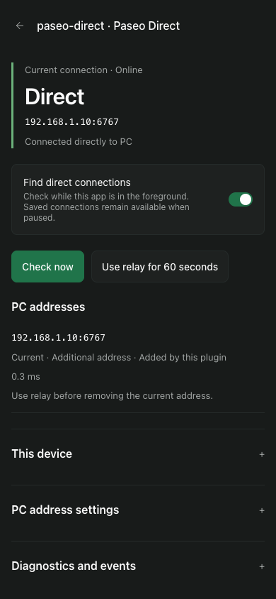

# Paseo Direct

Paseo 的前台直连管理插件。手机自动获取 PC 地址，通过 Paseo 握手和主机身份验证后，保存直连并按设备偏好切换，保留已有 Relay 回退。



**版本 1.0.1，支持 Paseo 0.13.0 及以上版本，不设版本上限。** 连接管理依赖 App 私有接口，运行时检查所需能力，接口缺失时停止操作。开发机制与边界见 [调研](docs/research/paseo-direct-feasibility.md)。

## 安装

在目标 PC 上，先启用 Paseo 插件功能并完成手机的 Relay 配对，再安装此版本：

```sh
paseo plugin add git:MinLeeV5/paseo-direct --ref v1.0.1
```

也可从本地源码目录安装：

```sh
paseo plugin install /absolute/path/to/paseo-direct
```

运行时无需在插件目录安装 npm 依赖。已有“直连实验”使用相同的插件 ID；更新源码后执行：

```sh
paseo plugin reload paseo-direct
```

分发包与校验文件见 [GitHub Release](https://github.com/MinLeeV5/paseo-direct/releases/tag/v1.0.1)，解压后同样安装其中的 `package` 目录。Paseo 官方目录需完成审核后才可使用目录 ID 安装。维护者发布流程见 [发布说明](docs/releasing.md)。

## 使用

在手机侧边栏打开 **Paseo Direct**，也可在此 PC 的插件设置中打开。手机端前台默认开启自动探测，网页和桌面默认关闭。请允许 Paseo 的本地网络访问权限。

- **优先直连**：验证地址可达且属于已配对 PC 后，将同一个连接交给 Paseo 保存和激活。
- **由 Paseo 选择**：验证并保存新地址，由 Paseo 的延迟策略决定实际连接；点击单个地址的“连接”可立即使用它。
- **使用 Relay 60 秒**：切换到已有 Relay 并暂缓插件的直连探测。可提前点击“恢复直连探测”。
- **移除地址**：只能移除插件添加且未在使用的地址；移除后在本设备排除，避免自动添加回来。原型及人工添加的地址由 Paseo 自身的连接设置管理。
- **暂停自动探测**：停止插件主动探测与切换。Paseo 仍可使用已保存的地址，并按自身逻辑探测和回退。

“本设备设置”中的开关、策略、间隔、超时、语言、排除列表和插件地址归属按 **当前设备 × PC** 保存，重启 App 后保留。连接计数与事件是本次 App 会话记录。

“PC 地址配置”是官方 host settings，供连接此 PC 的所有设备共享：可关闭地址发现、忽略 VPN 等网卡，或补充 DNS / IPv4 / IPv6 地址。支持 `host:port`、`ws://host:port`、`wss://host:port`，每行一个；不接受密码、任意路径及仅手机本机可用的地址。自动发现只提取当前 daemon 实际 TCP 监听中的 IPv4 地址，最多 16 个候选。

## 网络条件与边界

PC 的 TCP 端口必须能从手机访问。插件不会修改监听、防火墙、端口映射或 Relay 配置。无 TLS 的直连沿用 Paseo 的信任模型，适合可信 LAN / VPN；主机 ID 比对不等同于 TLS 身份认证。跨不可信网络应使用正确配置的 TLS 地址。

仅在 App 前台主动探测，不提供后台服务、NAT 打洞、Bonjour 或自动 IPv6 发现。完全离线时不能获取 PC 的新地址。已保存直连断开后的 Relay 回退由 Paseo 核心完成；插件观察回退并暂缓至少 30 秒，减少反复切换，随后按间隔重试。恢复 Wi-Fi 后可能要等待一个探测周期和重试退避。

已有 Android v0.13.2 真机验证：直连保存、关闭 Wi-Fi 后回到 Relay、恢复 Wi-Fi 后自动回直连。1.0 的设置与界面另行进行自动化和真实 Web App 验收；iOS 仍需真机验收。详见 [验证记录](docs/verification.md)。

## 诊断与数据

默认不上传诊断。展开“诊断与事件”并点击 **发送诊断到 PC**，才会向当前 PC 发送候选地址、连接状态、近期事件与验证计数；不包含主机密码或配对凭据。PC 内存最多保留 12 台设备的最近报告，插件日志也会保留报告，随 Paseo 日志策略处理。

```sh
npm ci --ignore-scripts
npm run reports
paseo plugin logs paseo-direct
```

本设备设置只写入插件自己的 `@paseo-direct:v1:<serverId>` 存储键；读取 App 的 host registry 确认持久保存，连接增删通过 App 的接口完成。不会把完整 host 对象或已有认证信息写入插件设置、页面或诊断。自定义地址属于 PC 共享设置，请勿在其中填写凭据。

## 开发与验证

```sh
npm ci --ignore-scripts
npm run verify
npm run release:pack
npm run verify:daemon -- dist/paseo-direct-1.0.1.tgz
```

`verify` 运行类型检查和连接行为回归。干净安装验证创建独立临时 daemon，测试分发包在无 `node_modules` 时的编译、RPC、PC 设置、身份与绑定端口，并确认清理；不会重启当前使用中的 daemon，也不会调用模型。CI 生成分发包及 SHA-256 校验文件。

源码分工：`server/` 发现与诊断，`shared/` 协议及设置，`client/bridge.ts` 私有适配器，`client/session.ts` 生命周期和策略，`client/screen.tsx` 管理页面。

## 停用与卸载

```sh
paseo plugin disable paseo-direct
# 或
paseo plugin remove paseo-direct
```

定时器、监听和未交接探测连接会被清理。已保存的连接继续由 Paseo 管理；如需移除，可先在插件中移除非活动的插件地址，或在 Paseo 的主机连接设置中管理。设备偏好不会随停用被删除。

[MIT License](LICENSE)
