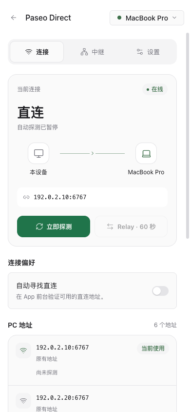

# Paseo Direct

Paseo 的前台直连与主机中继管理插件。手机自动获取 PC 地址，验证身份后保存并切换直连；也可经另一台已连接 VPN 的 Paseo PC 访问目标主机，保留已有连接。



**版本 1.2.4，支持 Paseo 0.13.0 及以上版本，不设版本上限。** 修复后台恢复时 Relay 先连接导致的自动中继误退避。连接管理依赖 App 私有接口，中继需宿主与 App 支持主机转发；运行时检查所需能力，接口缺失时停止操作。开发机制与边界见 [调研](docs/research/paseo-direct-feasibility.md)。

## 安装

在需要直连或充当中继的 PC 上，先启用 Paseo 插件功能并完成手机的 Relay 配对，再安装稳定版：

```sh
paseo plugin add git:MinLeeV5/paseo-direct --ref v1.2.4
```

已通过 Git 安装旧版的 B 可直接升级：

```sh
paseo plugin update paseo-direct --ref v1.2.4
```

升级到 1.2.4 后，请将提供此插件的各 PC 更新到同一版本，再将手机 Paseo 完全退出并重新打开一次，以重建共享选路策略和可能卡住的消息同步状态。后台恢复及切换 workspace 后“正在更新消息”的排查和修复见 [分析记录](docs/research/paseo-reconnect-0.15.md)。

也可从本地源码目录安装：

```sh
paseo plugin install /absolute/path/to/paseo-direct
```

运行时无需在插件目录安装 npm 依赖。已有“直连实验”使用相同的插件 ID；更新源码后执行：

```sh
paseo plugin reload paseo-direct
```

分发包与校验文件见 [GitHub Release](https://github.com/MinLeeV5/paseo-direct/releases/tag/v1.2.4)，解压后同样安装其中的 `package` 目录。Git 安装可直接指定此版本；官方插件目录版本以审核后的记录为准。维护者发布流程见 [发布说明](docs/releasing.md)。

## 使用

在手机侧边栏打开 **Paseo Direct**，也可在此 PC 的插件设置中打开。手机端前台默认开启自动探测，网页和桌面默认关闭。请允许 Paseo 的本地网络访问权限。

- **优先直连**：验证地址可达且属于已配对 PC 后，将同一个连接交给 Paseo 保存和激活。
- **由 Paseo 选择**：验证并保存新地址，由 Paseo 的延迟策略决定实际连接；点击单个地址的“连接”可立即使用它。
- **使用 Relay 60 秒**：切换到已有 Relay 并暂缓插件的直连探测。可提前点击“恢复直连探测”。
- **移除地址**：只能移除插件添加且未在使用的地址；移除后在本设备排除，避免自动添加回来。原型及人工添加的地址由 Paseo 自身的连接设置管理。
- **暂停自动探测**：停止插件主动探测与切换。Paseo 仍可使用已保存的地址，并按自身逻辑探测和回退。

**自动中继**有独立的设备偏好：在 B 的目标列表开启“自动优先此中继”，或在 A 的页面选择“优先使用的中继电脑”。手机到 B 的直连与 B 到 A 的通道可用时自动选择该路由；任一段失效时验证并恢复 A 已保存的原有连接。原有连接也不可达时继续重试，不保证离线目标可以连接。需先在手机保留 A 的 Relay 或直连配对。

“本设备设置”中的开关、策略、间隔、超时、语言、排除列表和插件地址归属按 **当前设备 × PC** 保存，重启 App 后保留。连接计数与事件是本次 App 会话记录。

“PC 地址配置”是官方 host settings，供连接此 PC 的所有设备共享：可关闭地址发现、忽略 VPN 等网卡，或补充 DNS / IPv4 / IPv6 地址。支持 `host:port`、`ws://host:port`、`wss://host:port`，每行一个；不接受密码、任意路径及仅手机本机可用的地址。自动发现只提取当前 daemon 实际 TCP 监听中的 IPv4 地址，最多 16 个候选。

## 通过另一台 PC 中继

当 B 已运行 Paseo 且登录 VPN，手机可先直连 B，再经 B 访问只有 VPN 内可达的 A。在 **B 的 Paseo Direct → 通过此 PC 中继** 中保存 A 的映射地址（例如 `192.0.2.42:16767`），按需单独填写 A 的 Paseo 密码。等待 B 连接成功，开启目标的 **自动优先此中继**，再在侧边栏选择 A；也可点击“使用此中继”仅手动切换一次。

主机转发自 1.1.0 提供，自动优先与回退自 1.2.0 提供，复用 Paseo 的主机转发，不需要手机登录 VPN 或在 B 上另开代理端口。目标由 B 的原生主机配置持久保存并向获准使用 B 的客户端共享；自动优先来源按手机与目标保存，一个目标只选择一个来源。完整配置步骤见 [VPN 电脑中继说明](docs/forwarding.md)。

## 网络条件与边界

PC 的 TCP 端口必须能从手机访问。插件不会修改监听、防火墙、端口映射或 Relay 配置。无 TLS 的直连沿用 Paseo 的信任模型，适合可信 LAN / VPN；主机 ID 比对不等同于 TLS 身份认证。跨不可信网络应使用正确配置的 TLS 地址。

仅在 App 前台主动探测，不提供后台服务、NAT 打洞、Bonjour 或自动 IPv6 发现。完全离线时不能获取 PC 的新地址。已保存直连断开后的 Relay 回退由 Paseo 核心完成；自动中继策略会另行验证并恢复目标原有的非转发连接。后台前健康的中继在回到前台后重新验证，B 的直连恢复后即可尝试切回；真正中继故障后等待至少 30 秒，连续失败最长退避 300 秒。手动选择 Relay 或指定直连时，自动中继也会暂停 60 秒。已保存路径仍由 Paseo 核心探测和选择。

已有 Android v0.13.2 真机验证：直连保存、关闭 Wi-Fi 后回到 Relay、恢复 Wi-Fi 后自动回直连。1.0 的设置与界面另行进行自动化和真实 Web App 验收；iOS 仍需真机验收。详见 [验证记录](docs/verification.md)。

## 诊断与数据

默认不上传诊断。展开“诊断与事件”并点击 **发送诊断到 PC**，才会向当前 PC 发送候选地址、连接状态、近期事件与验证计数；不包含主机密码或配对凭据。PC 内存最多保留 12 台设备的最近报告，插件日志也会保留报告，随 Paseo 日志策略处理。

```sh
npm ci --ignore-scripts
npm run reports
paseo plugin logs paseo-direct
```

本设备设置只写入插件自己的 `@paseo-direct:v1:<serverId>` 存储键；读取 App 的 host registry 确认持久保存，连接增删通过 App 的接口完成。不会把完整 host 对象或已有认证信息写入插件设置、页面或诊断。自定义地址属于 PC 共享设置，请勿在其中填写凭据。

## 开发与验证

```sh
npm ci --ignore-scripts
npm run verify
npm run release:pack
npm run verify:daemon -- dist/paseo-direct-1.2.4.tgz
```

`verify` 运行类型检查和连接行为回归。干净安装验证创建独立临时 daemon，测试分发包在无 `node_modules` 时的编译、RPC、PC 设置、身份与绑定端口，并用第二个带密码的临时 daemon 验证主机转发、错误密码拒绝与清理；不会重启当前使用中的 daemon，也不会调用模型。CI 生成分发包及 SHA-256 校验文件。

源码分工：`server/` 发现、诊断与主机转发管理，`shared/` 协议及设置，`client/bridge.ts` 私有适配器，`client/session.ts` 直连生命周期，`client/routing.ts` 共享自动中继策略，`client/screen.tsx` 管理页面。

## 停用与卸载

```sh
paseo plugin disable paseo-direct
# 或
paseo plugin remove paseo-direct
```

定时器、监听和未交接探测连接会被清理。已保存的连接与中继目标继续由 Paseo 管理；如需移除，可先在插件中移除非活动的插件地址与中继目标，或在 Paseo 的主机连接设置中管理。设备偏好不会随停用被删除。

[MIT License](LICENSE)
