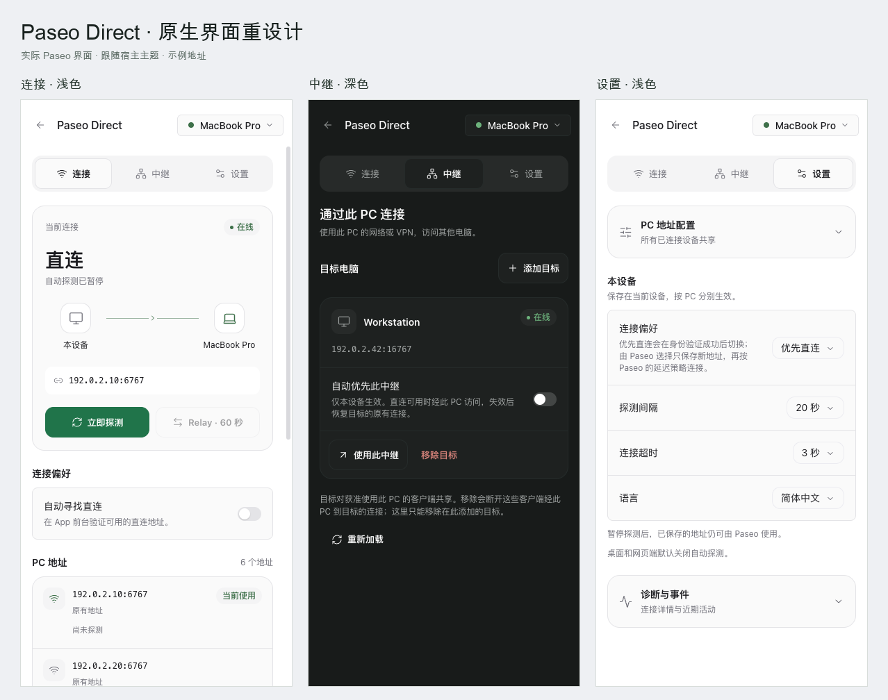

# Paseo Direct 原生界面重设计

用户方向：清爽原生，跟随 Paseo 主题，突出连接状态与常用操作。主要使用场景是手机前台确认、切换与管理到 PC 的连接。



此界面随 1.3.0 发布。预览来自实际 Paseo 0.15.0 Web bundle，使用独立测试主机，导出时仅把网络地址替换为文档示例值。

## 结构

采用「连接 / 中继 / 设置」三个入口，取代一页长列表中的多层折叠。连接页呈现当前状态、真实连接路径、探测 / Relay 操作、自动探测和地址列表；中继页管理目标与自动优先策略；设置页放设备偏好、PC 共享配置与诊断。

```text
连接                    当前 PC
[ 连接 ] [ 中继 ] [ 设置 ]
┌ 当前连接              ● 在线 ┐
│ 直连                         │
│ 本设备 ────────────── PC     │
│ 当前地址                     │
│ [立即探测] [Relay · 60 秒]   │
└──────────────────────────────┘
连接偏好
[ 自动寻找直连           开关 ]
PC 地址                   数量
[ 地址、来源、延迟和连接操作   ]
```

比较过保留整页折叠与拆分入口的方案。整页折叠会继续让中继功能淹没在低频配置里；三个入口更符合连接、管理目标、修改设置这三项独立任务。状态图只画实际路径，不暗示不存在的连通性。

## 视觉规范

颜色直接取自 `PluginSurfaceProps.theme`，支持宿主主题和用户主题。下表的色值仅用于浅色参考，代码使用语义 token，不固定这些颜色。

| 角色 | 参考色 | 宿主 token |
| --- | --- | --- |
| 页面底色 | `#F7F8FA` | `surface0` |
| 内容表面 | `#FFFFFF` | `surface1` |
| 控件底色 | `#EEF1F4` | `surface2` |
| 主要文字 | `#182026` | `foreground` |
| 次要文字 | `#707981` | `foregroundMuted` |
| 主要操作 | `#27805C` | `accent` / `accentForeground` |

状态使用宿主 `statusSuccess`、`statusWarning`、`statusDanger`，并提供文字，不仅靠颜色。沿用宿主页头，避免重复标题。文字承接系统 UI 字体：连接标题 28/34、分区标题 18/25、内容 14/21、说明 12/18；地址与时刻使用 Menlo / 平台等宽字体。以 4px 为间距基准，正文段落间距 16–24px，卡片 16–20px 内边距，按钮至少 44px。

界面的识别元素是一条克制的设备连接路径：直连显示两端，中继显示来源电脑或 Relay。其余区域保持安静，以原生控件和紧凑分组呈现，避免大数字统计、装饰性渐变和冗长技术说明。

## 交互

- 首次添加中继目标直接展示引导表单；已有目标时使用 SDK `Modal`，不受列表长度影响。保存成功关闭并清空表单，密码支持键盘提交。
- 已访问入口保留挂载与普通草稿，隐藏页面停止目标或设置轮询；离开中继页、关闭弹窗或提交时清空密码。PC 配置的 revision 冲突检查继续生效。
- 错误使用可访问的 alert，保存结果使用 polite live region。按钮与入口提供焦点边框、明确标签和禁用状态。
- PC 地址配置位于设置页首位；连接页空态的“配置地址”可直接进入展开后的表单。诊断保留手动发送，说明包含连接历史与隐私边界。

## 验证

已用实际 Paseo 0.15.0 Web bundle、专用无个人数据的浏览器和两台隔离 daemon 完成验收。

| 验证 | 结果 |
| --- | --- |
| 宿主编译与回归 | 客户端编译成功，TypeScript 与 115 项既有行为测试全部通过 |
| 主题与布局 | 跟随系统浅色 / 深色；中 / 英文；360px、390px 手机尺寸与 1200px 桌面无横向溢出 |
| 中继表单 | 空列表、非法地址、带密码保存、去重、移除、弹窗草稿、密码清理、成功重置与键盘提交通过 |
| PC 配置 | 非法配置拒绝、跨入口草稿、保存与重新读取通过 |
| 连接路径与故障 | 真实直连及三节点主机转发路径；目标停止后更新状态并禁用连接，恢复后可重新使用 |
| 诊断与键盘 | Tab 导航与 Enter 激活、可见焦点、诊断展开与清空事件通过；手动发送后在隔离 PC 确认收到 1 份报告 |

本地验收记录位于 Git 忽略目录 `test-results/redesign-ui/`。分发图使用文档示例地址，不作为网络测量证据。此次验收范围是实际 Web App 的手机尺寸与桌面浏览器，未替代 iOS / Android 真机验收。

另见 [实际主机转发路径截图](native-redesign-routed.png)。
